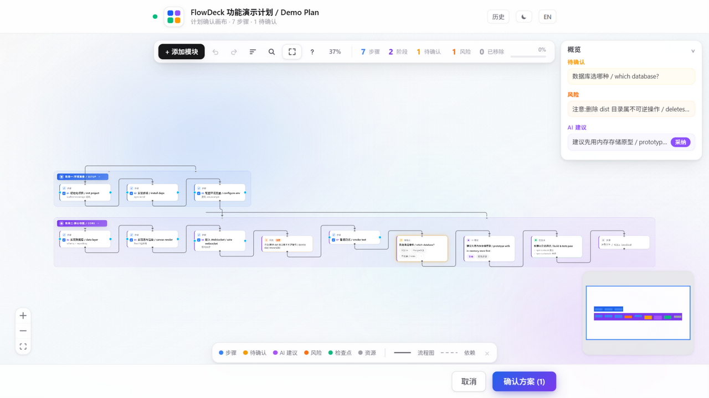
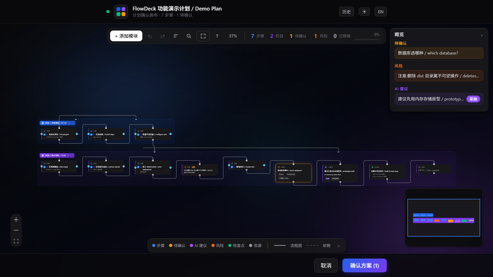

# FlowDeck · AI IDE 计划确认的框线图画布

[](https://www.npmjs.com/package/@flowdeck/mcp)
[](https://www.npmjs.com/package/@flowdeck/mcp)
[](./LICENSE)

> 用途:给第一次打开这个仓库的人。看完知道它是什么、能不能解决你的问题、怎么跑起来。

FlowDeck 把 AI 编程助手里"确认任务流程"这一步从一屏纯文本变成一张框线图:agent 把计划拆成
模块节点(步骤/问题/建议/风险/检查点/资源/阶段)摆上画布,你拖拽节点、拉线改顺序、点选答案,
点"确认方案"后结果自动流回 IDE 对话——零复制粘贴。给 agent 的输入是一份结构化计划,返回的是
按你的连线线性化后的 JSON + Markdown 摘要。




**7 种模块类型、端到端测试全绿**(复核:`npm run test:e2e`,预期输出含 ALL PASS)

## 安装与 MCP 接入

> **@flowdeck/mcp 尚未发布到 npm**(发布收口见 `scripts/prepare-publish.mjs` 清单)。
> 下面的 npx / 全局安装指令在发布后即可用;当前请走 [30 秒跑通](#30-秒跑通仓库开发路径)
> 的仓库开发路径。

发布后无需克隆仓库(Node ≥ 20):

```bash
npx -y @flowdeck/mcp serve      # 启动 MCP 服务器(IDE 配置即用)
npx -y @flowdeck/mcp history    # 打开历史确认记录查看器
npm i -g @flowdeck/mcp          # 或全局安装后直接用 flowdeck 命令
flowdeck open plan.md           # Markdown 计划 → 画布确认 → 打印最终摘要
flowdeck --help / --version     # 子命令与参数说明 / 版本号
```

IDE 的 MCP 配置(以 ZCode/Cursor 为例,六 IDE 完整接入见 [docs/ide-setup.md](docs/ide-setup.md)):

```bash
npx -y @flowdeck/mcp setup        # 一条命令写入检测到的 IDE 配置 + rules 片段(备份原文件,幂等)
npx -y @flowdeck/mcp doctor       # 本机自检:Node 版本 / 画布产物 / 历史目录 + IDE 配置提示
```

`setup` 还会自动把「让 Agent 主动调用画布」的 rules 片段写进 ZCode / Cursor / Claude Code
的规则文件;Qoder 配置自动写入 `~/.qoder/settings.json`,DSH / WorkBuddy 无标准配置文件,
setup 会打印各自的手编指引。
接入出问题先跑 `doctor`(三项真故障检查,任一失败退出码 1)。

或手动编辑(完整说明见 [docs/ide-setup.md](docs/ide-setup.md)):

```json
{
  "mcpServers": {
    "flowdeck": {
      "command": "npx",
      "args": ["-y", "@flowdeck/mcp", "serve"]
    }
  }
}
```

## 30 秒跑通(仓库开发路径)

```bash
# 在仓库根目录执行(首次需 npm install && npm run build)
node packages/mcp/bin/flowdeck.js docs/demo-plan.md
```

浏览器自动弹出一张框线图,拖一拖、点"确认方案",终端打印最终 Markdown 计划就说明装对了。
完整步骤与故障排查看 [上手手册](docs/GET-START.md)。

## 它能做什么

| 能力 | 怎么用 | 细节 |
|---|---|---|
| IDE 内弹出画布确认计划 | 在 MCP 配置里注册本服务 | [docs/ide-setup.md](docs/ide-setup.md) |
| VS Code 系 IDE(Cursor/Qoder/VS Code)内嵌画布 | 安装 `packages/vscode` 扩展(vsix),MCP 服务器 env 加 `FLOWDECK_OPEN_MODE=vscode` | [packages/vscode/README.md](packages/vscode/README.md) |
| 把 Markdown 计划变成画布 | `node packages/mcp/bin/flowdeck.js <文件>` | [docs/GET-START.md](docs/GET-START.md) |
| 回看历次确认记录(摘要可复制、条目可删除) | `node packages/mcp/bin/flowdeck.js history` | [docs/GET-START.md](docs/GET-START.md) |
| 无头回归测试 | `npm run test:e2e` | [docs/TESTING.md](docs/TESTING.md) |

## 目录怎么分

| 目录 | 负责 |
|---|---|
| `packages/core/` | 计划 schema、图算法(链→线性化)、Markdown 解析、摘要生成 |
| `packages/mcp/` | MCP 服务、画布宿主(HTTP/WS)、CLI |
| `packages/web/` | React 画布页(框线图画布,唯一编辑面) |
| `packages/vscode/` | VS Code 系内嵌扩展(IDE 窗口内显示画布,vsce 打包,不发布 npm) |
| `scripts/` | 端到端测试、交互演示驱动、发布准备 |

每块的细节在各目录 `README.md`,整棵树见 [目录说明](目录说明.md)。

## 已知做不到什么

- 终端型 agent(Claude Code/ZCode)没有可嵌入的 UI,画布只能以浏览器页呈现;VS Code 系
  (Cursor/Qoder/VS Code)经 `packages/vscode` 扩展内嵌 webview 面板(仓库内打包,见
  [packages/vscode/README.md](packages/vscode/README.md))。
- 连线语义自由:节点可任意连线(含一个节点多条下游的分支图与多起点),确认时从起点按
  深度优先顺序线性化成线性计划,断链节点按原顺序追加(绝不丢模块)。
- 画布服务不调用任何模型:问题选项、建议内容的质量取决于调用方 agent。
- 等待确认期间,画布 URL 会经 MCP logging 通知推送到对话侧:服务端发送已由 e2e 覆盖,
  但各 IDE 是否在对话 UI 直接展示取决于宿主实现,至少可在 IDE 的 MCP 日志里查看。

## 环境要求

Node.js ≥ 20(复核:`node -v`);安装依赖需访问 npm registry;运行时零 API key、零外部服务。

## 许可与引用

MIT,见 [LICENSE](LICENSE)。引用格式:`FlowDeck —— AI IDE 计划确认画布,https://github.com/Luz7818/flowdeck`。

---

维护:AI 改动本仓库前请读 [AGENTS.md](AGENTS.md)。
